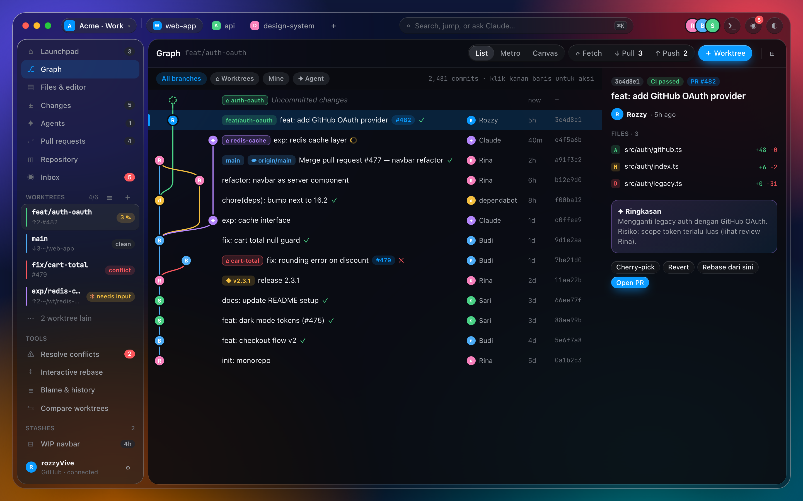
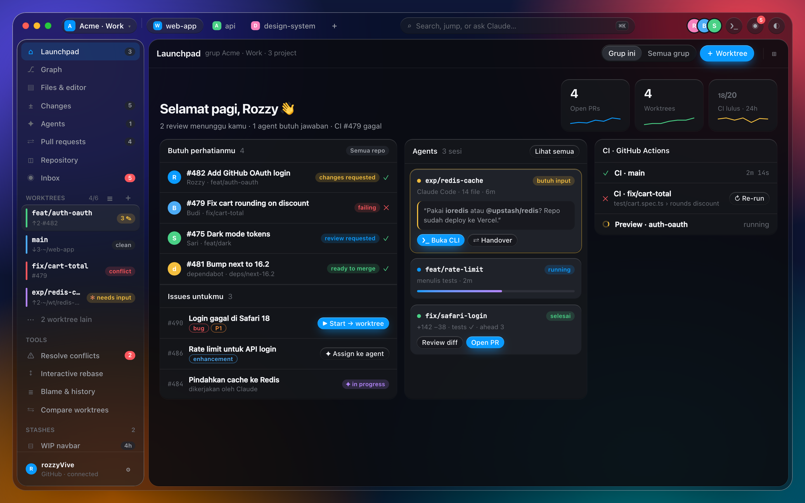
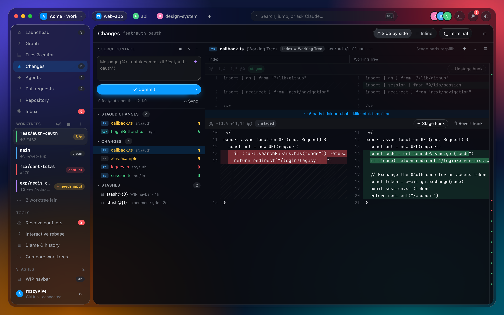
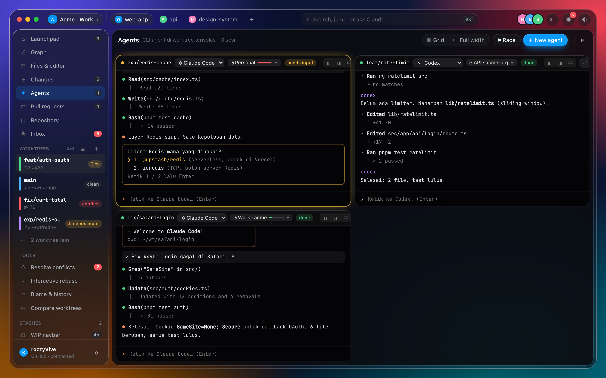
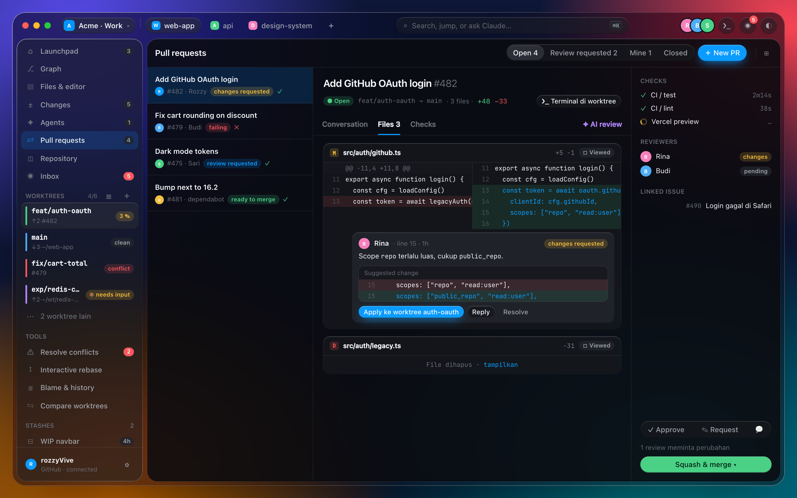
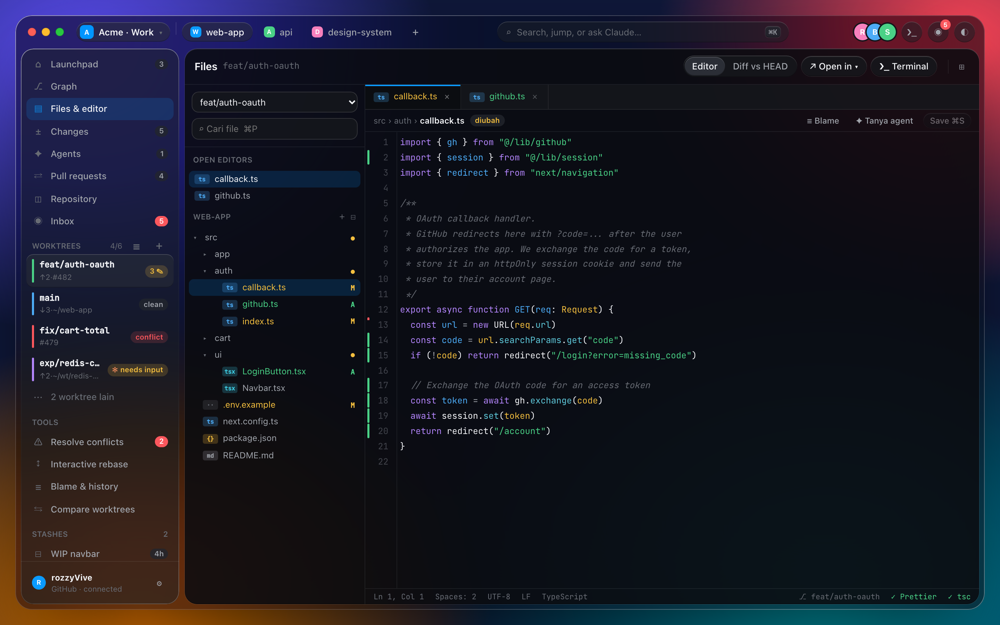
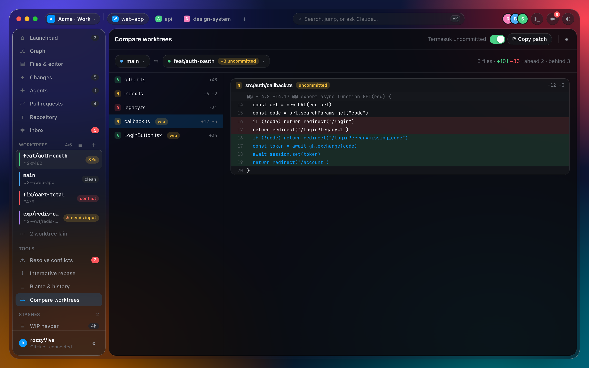
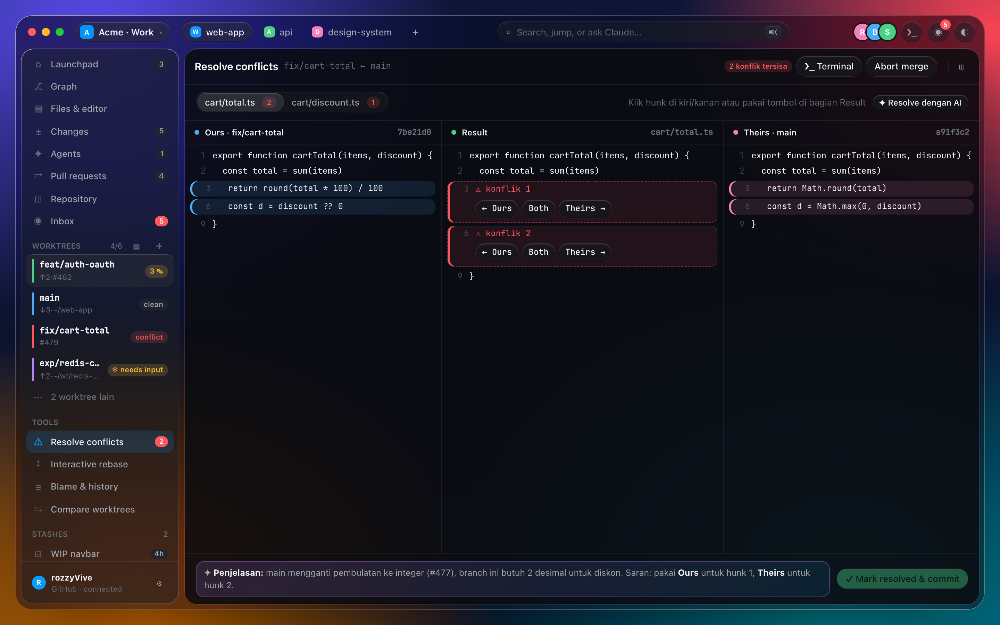

<picture>
  <source media="(prefers-color-scheme: dark)" srcset="public/branchwork-mark.png" />
  
</picture>

# Branchwork

A macOS Git client for developers who work across **many worktrees and branches at once**, often next to CLI coding agents such as Claude Code, Codex, OpenCode, Gemini CLI, GitHub Copilot and Muse.

Built with [Tauri 2](https://tauri.app) (Rust) and React + TypeScript.



> Screenshots come from the interactive design prototype (`docs/design/prototype.html`). The prototype's copy is in Indonesian because it was written during brainstorming; the app UI itself is English. See [Status](#status) for what is built so far.

## Why

- **Worktree-first.** "Many worktrees, many agents, one repo" is the main workflow. Each worktree gets its own state, terminal and agent sessions.
- **CLI-native agents.** Branchwork runs the real agent CLI in a PTY. It never rebuilds an agent chat UI.
- **Keyboard-first.** Every action is reachable from the command palette (⌘K).
- **Safe Git.** Destructive operations ask first, and can be undone wherever Git allows it (oplog snapshots, backup refs).
- **Native on macOS.** A translucent sidebar and toolbar over a solid content surface.

## Features

| | |
|---|---|
| **Launchpad**: PRs that need you, running agents and CI in one place. | **Changes**: VS Code–style source control with hunk/line staging, commit variants and stashes. |
|  |  |
| **Agents**: Claude Code, Codex, OpenCode, Gemini CLI, GitHub Copilot, Muse and custom CLIs running side by side in isolated worktrees, each with its own account profile. | **Pull requests**: review, suggested changes, checks and merge without leaving the app. |
|  |  |
| **Files & editor**: file manager plus a CodeMirror editor with git gutter, blame and history. | **Compare worktrees**: diff two worktrees, uncommitted changes included. |
|  |  |
| **Resolve conflicts**: a three-way Ours / Result / Theirs merge editor. | |
|  | |

Also in the plan: project groups, an Arc-style split view, a terminal dock and an iTerm-style terminal screen, interactive rebase, GitHub issues → worktree, Actions, an Inbox, and ✦ AI assists (commit messages, PR summaries, conflict explanations).

## Status

Delivered in milestones. Full plan: [design spec §11](docs/superpowers/specs/2026-11-06-branchwork-design.md).

| Milestone | Scope | State |
|---|---|---|
| M0 | Shell, design system, split view, palette, settings | ✅ Done |
| M1 | Repos, groups, worktrees, commit graph, file watcher | ✅ Done |
| M2 | Changes, files, editor, blame, oplog undo | 🚧 Stages 1–2 done (status, diff, staging, commits, stashes) |
| M3 | Terminal & agents | Planned |
| M4 | GitHub (PRs, issues, Actions, Inbox, Launchpad) | Planned |
| M5 | Advanced Git (conflicts, interactive rebase, compare) | Planned |
| M6 | AI assists | Planned |

v1 targets macOS only. Windows, Linux, GitLab and Bitbucket are out of scope.

## Development

Requirements: macOS, Node.js with [pnpm](https://pnpm.io), and a stable Rust toolchain.

```bash
pnpm install
pnpm tauri dev      # run the app
./init.sh           # full gate: typecheck, Vitest, clippy, cargo test
pnpm test:e2e       # Playwright end-to-end tests
```

### Project layout

```
src/           React UI: screens, state (zustand), IPC wrappers, i18n catalog
src-tauri/     Rust backend: git (git2 + git CLI), SQLite, file watcher, IPC commands
e2e/           Playwright tests
docs/          Design spec, plans, prototype, manual test specs
```

The TypeScript IPC bindings in `src/ipc/bindings.ts` are generated by tauri-specta. Regenerate them with `cargo test --lib -- --ignored regenerate_bindings_file` from `src-tauri/`. Don't edit the file by hand.

### Design references

- Spec: [`docs/superpowers/specs/2026-11-06-branchwork-design.md`](docs/superpowers/specs/2026-11-06-branchwork-design.md)
- Interactive prototype: [`docs/design/prototype.html`](docs/design/prototype.html) (open it in a browser)
